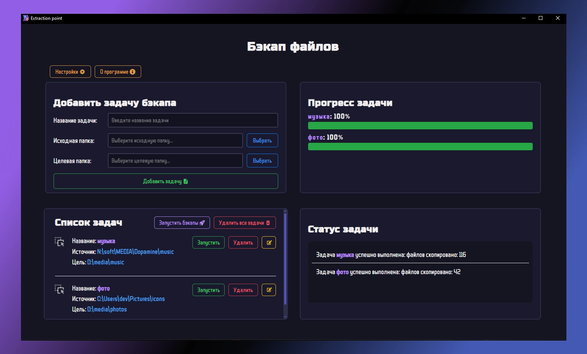

# Extraction Point

Открытое приложение для Windows, предназначенное для резервного копирования и переноса файлов между дисками и директориями

# Стек технологий

<table>
<tr>
<td>

</td>
<td>

</td>
<td>

</td>
<td>

</td>
<td>

</td>
</tr>
</table>

# Установка

Перейти в раздел [релиз](https://github.com/Nevionn/Extraction-point/releases) и скачать исполняемый файл

# Установка из исходников

## Зависимости

- Node.js: v22.x или выше ([Установить](https://nodejs.org/en))
- Rust ([Установить](https://rust-lang.org/tools/install/))

```bush
git clone https://github.com/Nevionn/Extraction-point.git

cd Extraction-point

pnpm install

pnpm tauri dev
```

# ССЫЛКИ ❤️

[](https://t.me/ancient_nevionn)
[](https://www.donationalerts.com/r/nevion)
